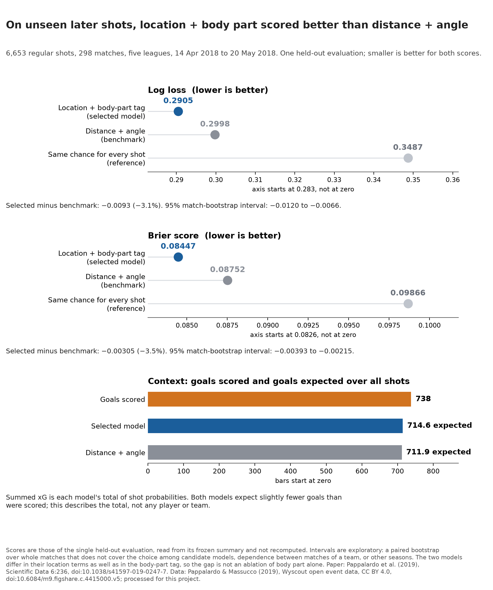
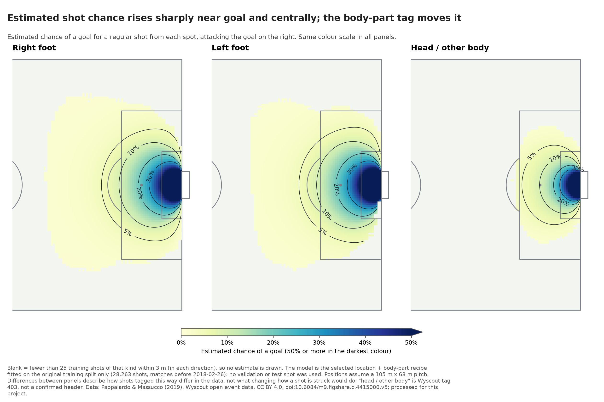
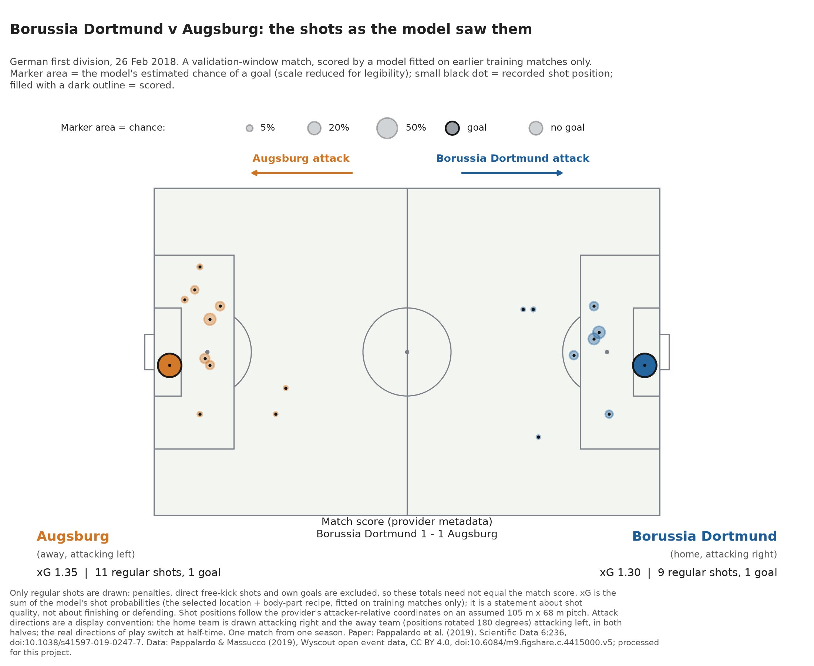

# How much does shot location explain, and does the body-part tag add anything?

An expected-goals (xG) model gives each shot a probability of becoming a goal. This project asks a narrow question on one season of public data: how much of a shot's quality is explained by where it is taken, and does the provider's body-part tag (right foot, left foot, head / other body) improve the estimate on shots the model has never seen?

*Figure 1. On 6,653 regular shots from a later, held-out window, the model using location and body part has lower log loss and Brier score than distance and angle alone. Values are read from the single held-out evaluation's frozen summary; the log-loss and Brier axes do not start at zero.*

## What was found where

- **Discovery, on training and validation matches only.** Three baselines (a constant rate, distance, distance plus angle) and two richer candidates (smooth location terms, with and without the body-part tag) were compared on a validation window. The body-part model scored best there (log loss 0.2845 against 0.2930 for distance plus angle), while smooth location terms alone were inconclusive. That choice was frozen in `docs/MODEL_SELECTION_DECISION.md` before any final-test number existed, and later diagnostics were not used to change it.
- **One-time check on held-out matches.** The two fixed recipes were refitted once on training plus validation (33,772 shots) and scored once on matches played 14 April to 20 May 2018 (6,653 shots, 298 matches, five leagues). Every number in Figure 1 and below comes from that run's frozen summary (`data/processed/final_test_summary.json`, SHA-256 `97a28e69...5edf`). Nothing in this report recomputes it or was used to select anything.

| Held-out result | Location + body part | Distance + angle | Same chance for every shot |
|---|---|---|---|
| Log loss (lower is better) | 0.2905 | 0.2998 | 0.3487 |
| Brier score (lower is better) | 0.08447 | 0.08752 | 0.09866 |
| ROC AUC (higher is better) | 0.787 | 0.767 | 0.500 |

Relative to distance plus angle, the body-part model's log loss is 3.1% lower and its Brier score 3.5% lower (differences of -0.0093 and -0.00305). A bootstrap over whole matches gives 95% intervals of -0.0120 to -0.0066 and -0.00393 to -0.00215. Under the rule fixed in advance, that counts as support for the location + body-part recipe over the distance + angle recipe on this window. The two recipes differ in their location terms (smooth curves rather than straight-line terms) as well as in the body-part tag, so the held-out comparison is not an ablation of body part alone. The comparison with smooth location terms but no body-part tag was made on the validation window only and was not part of the held-out evaluation; the held-out data therefore do not separate the two ingredients, and nothing here is a causal claim. Both models expected slightly fewer goals (about 715 and 712) than the 738 scored. Per league the same comparison points the same way in all five, descriptively and without intervals.

## What the model knows, and what it does not

It knows the distance to the goal centre, the angle the goal mouth subtends, and the provider's three-way body-part tag. It does not know where defenders and the goalkeeper stood, pressure, the type of assist, match state, the shooter, the team, or how the shot was struck. Penalties, direct free-kick shots and own goals are outside the cohort.

*Figure 2. Estimated chance of a goal for a regular shot from each spot, attacking the goal on the right, from a model fitted on the original training split only. Blank areas have fewer than 25 training shots of that kind nearby. "Head / other body" is Wyscout tag 403, not a confirmed header.*

*Figure 3. Borussia Dortmund v Augsburg, 26 February 2018, a validation-window match chosen by a rule fixed beforehand (earliest validation match with both teams shooting and at least 10 regular shots). Marker area is the estimated chance of a goal (the scale was reduced after the shot-origin audit so that markers do not cover the goal; probabilities are unchanged) and the small black dot is the recorded shot position; filled with a dark outline means scored. Attack directions are a display convention (home drawn attacking right, away attacking left in both halves), not the real direction of play. Regular-shot xG was 1.30 for Dortmund (9 shots) and 1.35 for Augsburg (11 shots); each team scored once from a regular shot and the provider's score is 1-1. These totals exclude penalties, direct free kicks and own goals, so they need not match the score.*

## Checking the shot locations

The model's location input is the start position the provider records for each shot, not where the shot ended. A development-only audit (`reports/shot_origin_audit.md`) found that the position used equals the first entry of the source event's `positions` for all 33,772 training and validation shots, and that goal rates rise smoothly towards the goal with substantial numbers of non-goals at every distance band. Six shots are recorded exactly on the goal line (four goals, two non-goals); they are a tiny share of the data and are flagged in the audit. In the Dortmund match both goals are recorded about 4 m from the goal centre; their minutes (16' and 73' of play) agree with a public match report (Sporting Life), which does not identify shot positions.

## How to read it

Comparing conversion rates without shot context can mislead: two players with the same conversion may have taken very different chances, which is what Figure 2 illustrates. xG describes the quality of the shots taken. It is not a measure of finishing skill, defending, tactics or a player's value, and a single match's xG says little on its own.

## Limits

- One season, five leagues, one provider, one chronological split. Nothing here says the model works in another season, another league or live play, or that it has been validated for scouting.
- The same teams and players appear in training, validation and test.
- Shots and body parts are provider tags; head / other body is not the same as a header. The body-part term is an association, not the effect of choosing how to strike a shot.
- Regular shots only: no penalties, direct free kicks or own goals. No goalkeeper, defender or pressure information.
- The bootstrap resamples matches; it ignores dependence between matches of one team or league and the choice of the primary model among candidates, so its intervals are exploratory.
- The test window was held out from scoring, not from all outcome information: its aggregate goal count could be inferred from published cohort totals before the evaluation.

## Data and build

Data: Pappalardo, L. & Massucco, E. (2019), *Soccer match event dataset*, figshare, [doi:10.6084/m9.figshare.c.4415000.v5](https://doi.org/10.6084/m9.figshare.c.4415000.v5), licensed [CC BY 4.0](https://creativecommons.org/licenses/by/4.0/); paper: Pappalardo et al. (2019), *A public data set of spatio-temporal match events in soccer competitions*, Scientific Data 6:236, [doi:10.1038/s41597-019-0247-7](https://doi.org/10.1038/s41597-019-0247-7). The data were collected by Wyscout and have been filtered to regular shots, quality-screened and augmented with derived geometry for this project; the changes are described in `docs/SHOT_DATASET_SPEC.md`. The dataset authors and Wyscout have not endorsed this work.

Figures are built with `uv run python -m expected_goals_lab.portfolio_figures` (specification: `docs/S08_VISUAL_SPEC.md`). `figures/portfolio/asset_inventory.md` records the shot-table and split hashes, the held-out summary hash, the model recipe and the file hashes. Figures 2 and 3 use the location + body-part recipe fitted on the original training split only; the build stops if that fit does not reproduce the recorded validation scores.
