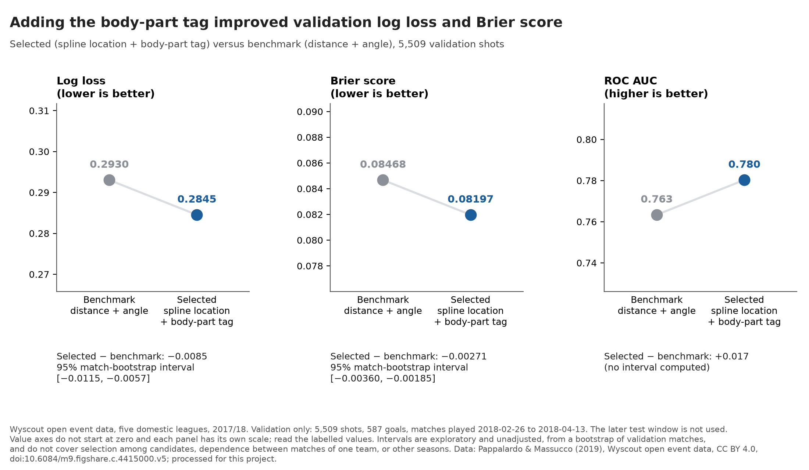

# Does the body-part tag help predict goals? Validation diagnostics (S05)

**Question.** When a shot is taken from a given spot, does knowing whether Wyscout tagged it as a right foot, left foot or head/body shot make the goal probability more accurate than distance and angle alone, and does that hold in every league?

**Finding.** On the 5,509 validation shots, adding Wyscout's body-part tag to flexible distance and angle curves gave better goal probabilities than distance and angle alone: log loss 0.2845 versus 0.2930 and Brier score 0.08197 versus 0.08468 (paired log-loss difference -0.0085, 95% interval [-0.0115, -0.0057]). The selected model has the lower log loss in 5 of 5 leagues and the lower Brier score in 5 of 5, and its predicted rate falls inside the observed-rate interval in 8 of 10 probability bins (benchmark: 10); these are descriptive counts, not tests. The body-part term is an association in tagged data, not the effect of heading: head/body shots convert more often overall, largely because they are taken closer to goal, but from the same spot the model gives them lower odds.

| Validation, 2018-02-26 to 2018-04-13 | Benchmark: distance + angle | Selected: spline location + body-part tag |
|---|---|---|
| Shots / goals / matches | 5,509 / 587 / 257 | 5,509 / 587 / 257 |
| Log loss (lower is better) | 0.2930 | 0.2845 |
| Brier score (lower is better) | 0.08468 | 0.08197 |
| ROC AUC | 0.763 | 0.780 |
| Selected minus benchmark, log loss |  | -0.0085 [-0.0115, -0.0057] |
| Selected minus benchmark, Brier |  | -0.00271 [-0.00360, -0.00185] |

**Limitation.** This is one season (2017/18), one contiguous validation window and provider-tagged data; the interval comes from a bootstrap of validation matches that ignores selection among candidates and dependence between matches of one team, so it supports a statement about these matches and not about other seasons. The later test window has not been scored.

Figures: [model comparison](../figures/validation_model_comparison.png) · [calibration](../figures/validation_calibration.png) · [body part and location](../figures/body_part_and_location.png) (SVG versions alongside).

---

## Method and diagnostics

Generated by `uv run python -m expected_goals_lab.evaluate_diagnostics` on 2026-10-21 05:53 UTC. Validation only; descriptive and exploratory except for the reproduction checks (`docs/DIAGNOSTICS_PROTOCOL.md`). The model decision (`docs/MODEL_SELECTION_DECISION.md`) is provisional and was fixed from S04 results before these breakdowns were computed. The test window has not been modelled or scored, and its row-level labels/features have not been accessed; however, its aggregate goal count is indirectly inferable from earlier cohort audit totals.

- Input table `data/processed/wyscout_regular_shots.csv` SHA-256 `58eb62c0f786406c7df1e457a981784ab10d0514ee5a3ec73c2119c83f0af96e`; split assignment SHA-256 `2f995fc0337436619f794d8c64c7f8397bf81d8e28deca9f2add8369c881da15`; diagnostics protocol SHA-256 `777fc02ea1c019eadcef4e0ebb2e6bfdbb5cf2ca73ca0c3587abe33ea788ac5c`.
- Git commit `fbd96a926816982db2719c15815db4b1908c71dc` (working tree has uncommitted changes); scikit-learn 1.9.1.
- Data: Pappalardo & Massucco (2019), Wyscout open event data, CC BY 4.0, doi:10.6084/m9.figshare.c.4415000.v5; collected by Wyscout; processed for this project.

| Check run before any diagnostic | Result |
|---|---|
| Split assignment equals the one S03 recorded (SHA-256 and row counts) | pass |
| Assignment SHA-256 and split sizes equal the published S03 values | pass |
| Regenerated S03 reference equals the committed S03 report (to its printed precision) | pass |
| Regenerated S04 validation numbers equal the committed S04 report (to printed precision) | pass |
| League shots and goals add up to the validation totals | pass |
| Calibration bin shots and goals add up to the validation totals | pass |
| Illustrative positions lie inside the training feature range | pass |

### A. By league (validation, descriptive)

Differences are selected minus benchmark, so negative means the selected model scored better. The bracketed intervals use the same match-cluster bootstrap as S04 and only indicate sampling noise: no threshold or significance label is applied, and the five leagues are not combined into a test. AUC is shown only with at least 10 goals and 10 non-goals.

| League | Shots | Goals | Matches | Conversion | LL benchmark | LL selected | LL diff [interval] | Brier benchmark | Brier selected | Brier diff | AUC benchmark | AUC selected |
|---|---|---|---|---|---|---|---|---|---|---|---|---|
| English first division | 967 | 112 | 45 | 11.58% | 0.3066 | 0.2971 | -0.0094 [-0.0158, -0.0029] | 0.08886 | 0.08591 | -0.00294 | 0.767 | 0.782 |
| French first division | 1170 | 125 | 51 | 10.68% | 0.2929 | 0.2840 | -0.0088 [-0.0157, -0.0021] | 0.08474 | 0.08164 | -0.00310 | 0.763 | 0.779 |
| German first division | 1002 | 114 | 47 | 11.38% | 0.3034 | 0.2954 | -0.0080 [-0.0150, -0.0006] | 0.08807 | 0.08535 | -0.00272 | 0.762 | 0.775 |
| Italian first division | 1120 | 111 | 52 | 9.91% | 0.2829 | 0.2751 | -0.0077 [-0.0143, -0.0011] | 0.08108 | 0.07855 | -0.00253 | 0.759 | 0.777 |
| Spanish first division | 1250 | 125 | 62 | 10.00% | 0.2835 | 0.2750 | -0.0086 [-0.0144, -0.0029] | 0.08188 | 0.07958 | -0.00230 | 0.765 | 0.786 |

Selected model has the lower log loss in 5 of 5 leagues and the lower Brier score in 5 of 5. League names come from the Wyscout competition mapping verified in S01B.

### B. Calibration (validation, no calibration fitted)

Ten equal-frequency bins per model. The Wilson 95% interval treats shots as independent and therefore understates uncertainty from shots within a match.

**Benchmark: distance + angle.** Sum of predictions 590.2 against 587 observed goals (mean prediction 10.71%, conversion 10.66%); 10 of 10 bins have the mean prediction inside the observed-rate interval.

| Bin | Shots | Goals | Mean prediction | Observed rate | 95% interval |
|---|---|---|---|---|---|
| 1 | 551 | 10 | 0.0178 | 0.0181 | [0.0099, 0.0331] |
| 2 | 551 | 9 | 0.0278 | 0.0163 | [0.0086, 0.0307] |
| 3 | 551 | 15 | 0.0377 | 0.0272 | [0.0166, 0.0444] |
| 4 | 551 | 22 | 0.0511 | 0.0399 | [0.0265, 0.0597] |
| 5 | 551 | 46 | 0.0671 | 0.0835 | [0.0632, 0.1096] |
| 6 | 551 | 50 | 0.0849 | 0.0907 | [0.0695, 0.1176] |
| 7 | 551 | 70 | 0.1070 | 0.1270 | [0.1018, 0.1575] |
| 8 | 551 | 73 | 0.1373 | 0.1325 | [0.1067, 0.1634] |
| 9 | 551 | 108 | 0.1868 | 0.1960 | [0.1650, 0.2312] |
| 10 | 550 | 184 | 0.3542 | 0.3345 | [0.2964, 0.3750] |

**Selected: spline location + body-part tag.** Sum of predictions 589.3 against 587 observed goals (mean prediction 10.70%, conversion 10.66%); 8 of 10 bins have the mean prediction inside the observed-rate interval. The bins that miss are bin 4 (by 0.0002), bin 5 (by 0.0009); the gap is the distance in probability between the bin's mean prediction and the nearest edge of its interval.

| Bin | Shots | Goals | Mean prediction | Observed rate | 95% interval |
|---|---|---|---|---|---|
| 1 | 551 | 9 | 0.0183 | 0.0163 | [0.0086, 0.0307] |
| 2 | 551 | 7 | 0.0237 | 0.0127 | [0.0062, 0.0260] |
| 3 | 551 | 18 | 0.0320 | 0.0327 | [0.0208, 0.0510] |
| 4 | 551 | 15 | 0.0446 | 0.0272 | [0.0166, 0.0444] |
| 5 | 551 | 46 | 0.0623 | 0.0835 | [0.0632, 0.1096] |
| 6 | 551 | 43 | 0.0824 | 0.0780 | [0.0585, 0.1035] |
| 7 | 551 | 63 | 0.1066 | 0.1143 | [0.0904, 0.1436] |
| 8 | 551 | 81 | 0.1382 | 0.1470 | [0.1199, 0.1790] |
| 9 | 551 | 94 | 0.1847 | 0.1706 | [0.1415, 0.2043] |
| 10 | 550 | 211 | 0.3773 | 0.3836 | [0.3439, 0.4250] |

### C. Body-part tag class: association, not a causal effect

Wyscout `head_or_body` is tag 403 ("head/body"): it mixes headers with other body-part shots and is **not a confirmed header**. A class with fewer than 30 shots in a group is marked sparse.

**C1. Raw, as observed.**

*Train*

| Class | Shots | Goals | Goal rate | 95% interval | Median distance (m) | Within 12 m |
|---|---|---|---|---|---|---|
| right foot | 14514 | 1416 | 9.76% | [9.28%, 10.25%] | 19.3 | 2127 (15%) |
| left foot | 9239 | 945 | 10.23% | [9.63%, 10.86%] | 19.0 | 1295 (14%) |
| head/body (tag 403) | 4510 | 582 | 12.90% | [11.96%, 13.91%] | 10.5 | 3122 (69%) |

*Validation*

| Class | Shots | Goals | Goal rate | 95% interval | Median distance (m) | Within 12 m |
|---|---|---|---|---|---|---|
| right foot | 2729 | 288 | 10.55% | [9.46%, 11.76%] | 19.0 | 385 (14%) |
| left foot | 1860 | 191 | 10.27% | [8.97%, 11.73%] | 18.4 | 280 (15%) |
| head/body (tag 403) | 920 | 108 | 11.74% | [9.82%, 13.98%] | 10.5 | 650 (71%) |

**C2. Validation shots: observed against each model's mean prediction.** The benchmark uses location only; the selected model also uses the tag.

| Class | Shots | Observed rate | Benchmark mean prediction | Selected mean prediction |
|---|---|---|---|---|
| right foot | 2729 | 10.55% | 8.65% | 9.90% |
| left foot | 1860 | 10.27% | 8.78% | 10.69% |
| head/body (tag 403) | 920 | 11.74% | 20.73% | 13.07% |

The location-only benchmark over-predicts head/body shots: it averages 20.7% against 11.7% observed (920 shots); the selected model averages 13.1%. That mis-estimate, in a class concentrated close to goal, is where the tag adds information.

**C3. Fitted body-part terms (train).** Log-odds scale, L2-penalised, after the spline terms for location; only differences between classes mean anything.

| Class | Coefficient |
|---|---|
| head_or_body | -1.3206 |
| left_foot | -0.3187 |
| right_foot | -0.3899 |

**C4. Why a higher raw rate can coexist with a lower adjusted term.** Head/body shots convert more often than foot shots in both windows (validation 11.7% versus 10.4%), yet the fitted head/body term (-1.32) is the lowest of the three. The raw gap is largely a matter of location: head/body shots are taken closer to goal (validation median 10.5 m versus 18.4–19.0 m for the feet; 71% within 12 m versus 14%). Once the model knows where the shot was taken, it gives a head/body shot lower odds than a foot shot from the same spot. A plausible football reading, which these data cannot test, is that close-range head/body shots often follow crosses with defenders and the goalkeeper nearby, while close-range foot shots include cut-backs and through balls that leave more time.

**C5. Fixed-location illustrations (model predictions, not observations).** The selected model's predicted probability for each class at four fixed positions chosen before any result was seen. 'Nearby' counts training shots of that class within 1.5 m of the position's distance and 5 degrees of its angle; fewer than 30 means the prediction there is extrapolated. These are not a measured effect of changing how a shot is struck: shots are not assigned a body part at random.

| Position | Distance (m) | Right foot | Left foot | Head/body (tag 403) |
|---|---|---|---|---|
| central, penalty-spot area (x 90, y 50) | 10.5 | 23.8%; nearby 599 | 25.1%; nearby 384 | 11.0%; nearby 1080 |
| central, edge of the box (x 84, y 50) | 16.8 | 10.4%; nearby 1069 | 11.1%; nearby 675 | 4.4%; nearby 123 |
| wide inside the box (x 90, y 35) | 14.6 | 11.3%; nearby 1308 | 12.0%; nearby 902 | 4.8%; nearby 332 |
| central, long range (x 75, y 50) | 26.2 | 2.8%; nearby 1704 | 3.0%; nearby 1078 | 1.1%; nearby 2 (sparse) |

### D. Robustness and limits

- **Goal-line records.** The seven `x_pct = 100` records and the S02 quarantine policy are unchanged in the main analysis. S04's own sensitivity left the 2 validation goal-line shots (2 goals) out of scoring only, without refitting: the selected model still scored better than the benchmark on log loss (0.2841 versus 0.2928) and Brier score (0.08184 versus 0.08457). It is repeated from S04, not re-optimised.
- **Coordinates and tags.** Positions are integer percentages with an assumed 105 x 68 m pitch; labels and body-part tags come from human provider tagging; `head_or_body` is coarse.
- **Design.** One season, five leagues, one chronological cut. The same teams and players appear in the train, validation and test windows.
- **Uncertainty.** Match-level resampling does not capture dependence between matches of the same team or league, nor the selection of this model among candidates. League rows are small, their intervals wide, and no inferential threshold is applied.
- **Not done.** No calibration fitting, no new feature or model, no change to the cohort or the decision, and no scoring of the held-out test window.

### Post hoc additions and departures

Four reporting and presentation additions were made after the first run had been seen; none changes the data, models, split, calculations, thresholds or the fixed decision: (1) naming the calibration bins whose interval misses the mean prediction, (2) the sentence on the benchmark's over-prediction of head/body shots, (3) hedged wording of the football explanation and a softened first-screen sentence, (4) figure re-layout after inspection and clamped Wilson intervals. See `docs/DIAGNOSTICS_PROTOCOL.md`, section 10.
